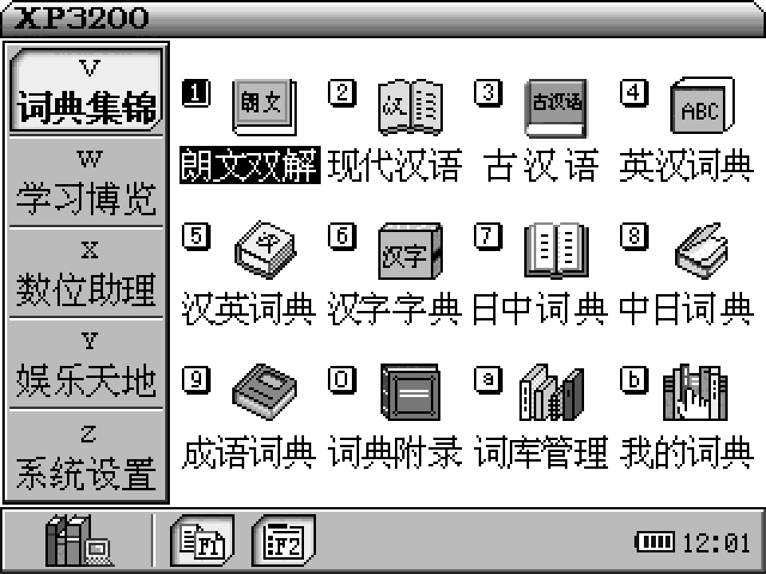
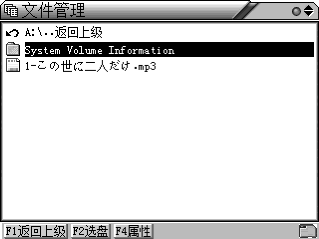
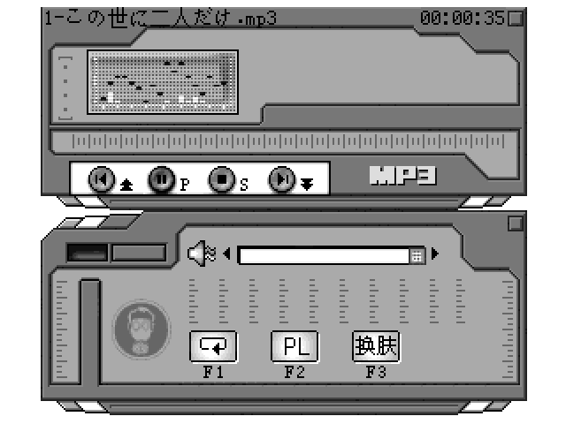
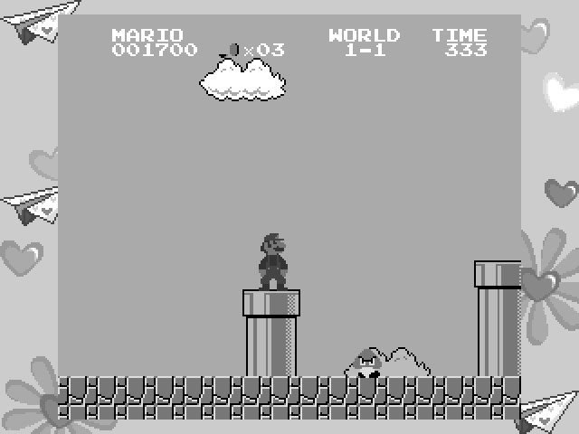

# 快易典 XP3200 QEMU 模拟器

这是基于 QEMU 11 实现的快易典 XP3200 硬件模拟器，模拟 Epson S1C33L05
处理器、`320 × 240` 屏幕、5 行 × 14 列键盘、NAND/NOR、SD 卡、VS1003
音频及相关板级硬件。

源码仓库和模拟器 ZIP 不包含原厂固件、NAND 镜像或 SD 卡镜像。可以运行
Release 中单独提供的测试镜像，或使用自己从真机备份的镜像。

本模拟器基于 [bbk9288-emulator](https://github.com/HelloClyde/bbk9288-emulator)
修改而来：QEMU 基础、S1C33 CPU、9288 机型及其工具都来自上游；XP3200 机型
`hw/s1c33/xp3200.c` 与配套文档/脚本为本项目新增。仓库中仍保留 9288 的
源码与工具（`bbk9288s.c`、`run-bbk9288*`、`web/` 等），与 XP3200 互不影响。

## XP3200 硬件配置

| 项目 | 规格 |
|---|---|
| 处理器 | EPSON S1C33L05 |
| 存储 | 8 MB SDRAM（HY57V641620HGT）；1 MB NOR FLASH + 128 MB NAND FLASH（K9F1G08U0D） |
| 显示 | 320 × 240，4 bpp，16 级灰度 STN-LCD |
| 声音 | VS1003B |
| 键盘 | 67 键（5 行 × 14 列矩阵键盘） |
| 外部接口 | USB 1.1 mini USB-B；2.5 mm 耳机接口 |
| 供电 | 2 节 7 号电池，或从 USB 接口取电 |

引脚与地址连接见 [硬件连接](docs/xp3200/hardware.md)。

## 效果预览

系统主菜单（词典集锦/学习博览/数位助理/娱乐天地/系统设置）：



SD 卡（A 盘）文件管理，支持中文/日文长文件名：



固件自带 MP3 播放器，从 SD 卡读取并送 VS1003 解码：



`下载游戏` 里的 NES 游戏（MARIO）：



## 已实现

- QEMU machine type：`xp3200`。
- 320 × 240 LCDC、IVRAM 及 1/2/4/8 bpp 调色板渲染，支持 `debug-lcd-dump-*`
  导出 PGM 帧用于自动化验证。
- S1C33L05 标准外设：16 位/8 位定时器、HSDMA、SIO、中断控制器等启动与
  日常运行所需部分。
- 看门狗（16TM0）：固件每约 10 ms 向 `0x0048186` 写 `0x23` 喂狗；模型据此
  维持 2 秒超时，超时复位整机，可复现“不喂狗的程序跑几秒就重启”的真机行为。
- NOR 启动：`-bios` 执行原机 NOR 中的龙腾 V1.1 引导/恢复系统，再加载
  NAND 中的主 OS（`XP3200V1.9.5`）。
- Samsung 兼容 128 MiB NAND、2 KiB 页、OOB，NAND 按脏块增量回写；
  原厂 FTL / `NFDISK` FAT16 文件系统可读。
- 5 行 × 14 列键盘矩阵：`0x00300F46` 行选通、K5/P0 列输入、K6.4 唤醒，
  第 5 行热键（音量/Font/Catalog/U 盘等）已全部打通。
- 按键即时唤醒：矩阵键不再需要长按约 1 秒才响应。
- SD 卡（S1C33L05 MMC，SPI 模式）：CMD0/1/8/9/10/12/13/16/17/18/24/25/55/58/59，
  MBR + FAT16（A 盘），支持中文/日文 VFAT 长文件名。
- 固件 CSD 字节序适配：按固件解析方式生成 CSD，扇区上限正确（见
  [技术说明](docs/xp3200/progress.md) 第 13 节）。
- VS1003 压缩音频数据通路：固件从 SD 卡读取 MP3 并送解码器，模型通过
  `audio-player`（如 `ffplay`）播放；已实测播放 35 秒、送解码器数据与
  卡上文件逐字节一致。
- NES 游戏：`下载游戏` 中的 `.GAM`/`.NES` 可正常进入并操作。
- SD 卡镜像工具（图形界面 + 命令行），见下文。
- 调试支持：GDB-RSP stub、`debug-lcd-dump-*`、`debug-call-*`、`debug-sd-insert-ms`、
  `F12` 工厂自检菜单等。

当前固件可进入完整主菜单，词典/学习/娱乐/系统设置各页面可操作，
文件管理可浏览 A 盘（SD 卡）和 C 盘（NAND），MP3 可播放，NES 游戏可运行。

## 快速开始

仓库不包含原厂固件与镜像。运行前需要准备：

- NOR 镜像（原机 1 MiB NOR FLASH，或等价引导 ROM）；
- NAND 镜像（128 MiB，含 `NFDISK` 文件系统）；
- 可选：SD 卡镜像（FAT16，可用下方工具生成）。

启动：

```bash
./_build/qemu-system-s1c33 \
  -M "xp3200,nand-image=nand.img,sd-image=sdcard.img" \
  -bios nor.bin \
  -cpu c33l05,exit-on-halt=off \
  -display gtk
```

- `-display gtk` 需要图形环境（WSL2 下需 WSLg）；无图形时用 `-display none`。
- 听声音时加 `,audio-player=/usr/bin/ffplay`：模型把固件送 VS1003 的压缩流
  通过管道交给 ffplay 解码播放。
- 热插拔 SD 卡调试：`,debug-sd-insert-ms=<毫秒>`（开机时卡不在位，到点后插入）。

## 构建

在 Linux / WSL2 中：

```bash
# 在仓库根目录执行
mkdir -p _build && cd _build
../configure \
  --target-list=s1c33-softmmu \
  --without-default-features \
  --enable-tcg \
  --enable-pixman \
  --disable-sdl \
  --enable-gtk \
  --enable-vnc \
  --disable-docs \
  --disable-tools \
  --disable-werror \
  --enable-download
ninja qemu-system-s1c33
```

依赖：`build-essential ninja-build meson pkg-config libglib2.0-dev
libpixman-1-dev libgtk-3-dev`。

确认机型：

```bash
./qemu-system-s1c33 -machine help | grep xp3200
```

## SD 卡镜像工具

`scripts/xp3200/` 提供生成和编辑 FAT16 SD 卡镜像的工具：

- `SDImageTool.ps1`：Windows 图形界面（新建镜像、编辑已有镜像、添加/删除文件）；
- `sd_image.sh`：命令行入口（`create` / `add` / `delete` / `list`）；
- `fat16_list.py`、`fat16_lba.py`、`mk_mbr.py`：镜像解析与 MBR 写入。

生成规则与真机 128 MB 卡一致：MBR 分区表（类型 `0x06`，起始 LBA 97）+
FAT16，支持中文/日文长文件名。需要 `dosfstools`（`mkfs.vfat`）和 `mtools`。

```bash
bash scripts/xp3200/sd_image.sh create ~/card.img 128 "SD CARD" ~/音乐 ~/电子书
```

详见 [SD 卡镜像工具](docs/xp3200/sdcard-tool.md)。

## 键盘

按键映射（PC 主机键 → 本机键、矩阵行列、固件位置）见
[键盘映射](docs/xp3200/keyboard.md)。整机 5 × 14 矩阵 67 键全部可映射，
包括第 5 行的音量、字体、U 盘、词典、发音等热键。

## 调试

- GDB-RSP：`-gdb tcp::2349`，可下断点、单步、读写 guest 内存；
- LCD 帧导出：`,debug-lcd-dump-path=<前缀>` + QMP `debug-lcd-dump-seq`；
- 工厂自检菜单：按 `F12`（等价 `debug-call-addr=0x0217D6CE`）；
- SD 热插拔：`,debug-sd-insert-ms=<毫秒>`；
- 软中断（`int`）跟踪：`-cpu c33l05,trace-int=on -d int`（默认关，只打
  `s1c33-int:` 的向量地址/目标/PSR/TTBR；不开 `-d int` 时无输出、也无开销）。

源码组织与阅读顺序见 [源码结构与阅读指南](docs/xp3200/source-guide.md)；
更完整的调试记录与逆向过程见 [移植进度](docs/xp3200/progress.md)。

## 机型

| `-M` | CPU 核 | 说明 |
|---|---|---|
| `xp3200` | S1C33L05 | 本仓库主体：320×240、5×14 键盘、NOR+NAND、SD、VS1003 |
| `xp3200s` | S1C33L05 | XP3200 开发机型（同一板级模型） |
| `bbk9288`、`bbk9288s` | S1C33L05 | 上游 bbk9288-emulator 的机型 |
| `g9001` | S1C33E08 | **研究机型**：精工 SII G9001 日文词典，640×480 单色 TFT |

XP3200 的 320×240 LCD 由 `hw/s1c33/xp3200.c` 渲染。G9001 在 `hw/s1c33/g9001.c` 按该机型的 640×480 4bpp 布局读取 SDRAM，每字节先显示低半字节对应的像素。两个机型分别验证自己的显示输出。

`g9001` 与 XP3200 共用同一份 `target/s1c33` CPU 核，但两个核心的寻址宽度不同：
L05 是 28 位内部地址总线、TTBR bit31:28 固定 0；E08 保持完整 32 位（SDRAM 在
`0x10000000` 以上）。差异由 CPU 的 `core-variant` 属性选择（默认 `l05`），
`-M g9001` 会选 `e08`，所以两边互不影响。

改过 `target/s1c33` 后请同时跑两个冒烟脚本（需要自备镜像）：

```bash
NAND=nand.img NOR=nor.bin bash scripts/xp3200/smoke.sh   # 主菜单/词典/返回
NAND=g9001-nand.bin    bash scripts/g9001/smoke.sh      # 引导 + E08 OS 入口 + LCD
```

`.github/workflows/smoke.yml` 在 Linux 上构建并检查 5 台机器；把镜像放到
仓库变量 `XP3200_NAND_URL` / `XP3200_NOR_URL` / `G9001_NAND_URL` 后，两条冒烟也会
在 CI 里跑。`g9001` 的 `slp-as-nop` 是机型属性（默认开），可用
`-M g9001,slp-as-nop=off` 关掉。

## G9001 用法

在 Linux 或 WSL2 中从仓库根目录执行。图形窗口需要 GTK 后端，WSL2 下使用 WSLg。将 `NAND` 换成从设备提取的原始 NAND 路径。下面的坏块表对应已验证的 `NAND08GW3B2C.bin`，其他提取方式需使用对应的坏块表。

```bash
QEMU=./_build/qemu-system-s1c33
NAND=/path/to/NAND08GW3B2C.bin
M="g9001,nand-image=$NAND,nand-bad-blocks=286:509:1303:1305:2319:3343:4806"
"$QEMU" -M "$M,audio-player=ffplay" \
    -cpu c33l05,exit-on-halt=off -display gtk -monitor none -serial none
```

等到 640×480 的「複数辞書一括検索」界面出现，再聚焦窗口操作。NAND 默认只读打开，固件改动保存在本次进程的内存覆盖层。用 `,audio-player=ffplay` 启用词典录音播放，或用 `,audio-output=pronunciation.mp3` 导出最近一次发音。

| 操作 | PC 键 |
|---|---|
| 词典与收藏 | `F1` 広辞苑，`F2` 英和，`F3` 和英，`F4` ブリタニカ，`F5`–`F7` 商用词典，`F8`–`F9` 收藏 |
| 菜单、卡、电源 | `F10` 或菜单键打开菜单，`F11` 进入扩充卡，`F12` 熄屏并在同一次 QEMU 运行中恢复原词条 |
| 输入与查词 | `Tab` 一括搜索，`Insert` 例文・成句搜索，字母键输入，方向键选候选，`Enter` 打开，`Esc` 返回或清空 |
| 翻页与历史 | `Page Up` / `Page Down` 切换前后见出し，左右键翻页，`Home` 打开履历 |
| 显示 | `[` 译文显示切换，`]` 双搜索，反斜杠切换显示样式，`=` 切换字号 |
| 词条动作 | `'` 成句・熟语，`,` 例文・解说，`.` 跳转，`;` 拼写，`/` 检查或通配符，`Delete` / `Backspace` 登记・删除 |
| 数字与计算 | 数字行及小键盘 `1`–`0` 与 Q–P 共用实体键，连字符用 `-`。小键盘的点、除、乘、减、加及等号使用固件的实体键副标 |

**原始词典扩充卡**使用 `dict` 模式，只读挂载 `dict.img`。**普通 SD** 使用 `sd` 模式和整卡 raw 镜像，固件写入会保存到该文件。已验证 128 MiB 标准容量 SD。

```bash
# 在启动命令的 -M 字符串末尾追加对应的卡参数
# 词典扩充卡  ,spi-card-type=dict,spi-image=/path/to/dict.img
# 普通 SD    ,spi-card-type=sd,spi-image=/path/to/sd128.img
```

内置英和词典打开 `apple` 的全文后，按一次 `Enter` 选中扬声器，再按一次播放。挂载扩充卡后按 `F11`，再按 `Enter` 进入中日词典。输入 `ni`，等候候选出现，用 `Enter` 打开「妮」，在全文再按一次 `Enter` 发音。

无窗口抓屏时，在约 15 秒处导出一帧。可调大两处时间参数以等待较慢的启动。

```bash
timeout 25 "$QEMU" \
    -M "$M,debug-lcd-dump-ms=15000,debug-lcd-dump-path=g9001.pgm" \
    -cpu c33l05,exit-on-halt=off -display none -monitor none -serial none
```

冒烟测试使用本地镜像，矩阵测试无需镜像，发音回归需安装 FFmpeg。

```bash
NAND="$NAND" QEMU="$QEMU" bash scripts/g9001/smoke.sh
python3 scripts/g9001/keyboard_matrix_smoke.py
python3 scripts/g9001/keyboard_smoke.py --nand "$NAND" --power-cycle --pronunciation
python3 scripts/g9001/keyboard_smoke.py --nand "$NAND" --card /path/to/dict.img \
    --card-lookup --pronunciation --out _build/g9001-card-smoke
```

## 代码结构

- `hw/s1c33/`：S1C33 板级设备；`xp3200.c` 为 XP3200 machine（LCD、NAND、NOR、
  键盘、SD、音频、定时器等），`g9001.c` 为 G9001 研究机型。
- `target/s1c33/`：Epson S1C33 CPU 翻译、指令 helper 和反汇编；`core-variant`
  在这里按型号选择寻址宽度。
- `docs/xp3200/`：硬件连接、键盘映射、源码阅读指南、SD 卡工具说明、移植进度与技术笔记。
- `scripts/xp3200/`：SD 卡镜像工具与冒烟测试；`scripts/g9001/`：G9001 启动、显示、键盘和发音回归。

## 资料依据

- [Epson S1C33L05 Technical Manual](https://www.epson.jp/prod/semicon/pdf/id000446.pdf)：
  CPU、IVRAM、LCDC、NAND、串行接口及寄存器定义。
- 真机采集的 NOR/NAND/SD 镜像与逻辑分析数据（不随仓库分发）。

## 当前限制

- C 盘（NAND `NFDISK`）目前只读；写入需要 U 盘连接（USB 设备模式）或
  离线 FTL 写入，尚未实现。
- 音频由 `ffplay` 负责 MPEG 解码，不模拟 VS1003 内部音质、模拟输出和
  全部 SCI 扩展行为。
- USB、部分板级扩展寄存器仍为实验性模型。
- 此项目是非官方逆向工程，与快易典、Epson 或 QEMU 项目没有隶属关系。

## 许可证

模拟器源码沿用 QEMU 的许可证体系；整体按仓库根目录 `LICENSE`、`COPYING`
和各源文件中的许可证声明发布。请勿在 Issue、PR 或提交中上传无权再分发的
原厂固件、NAND 镜像、说明书或安装包。
