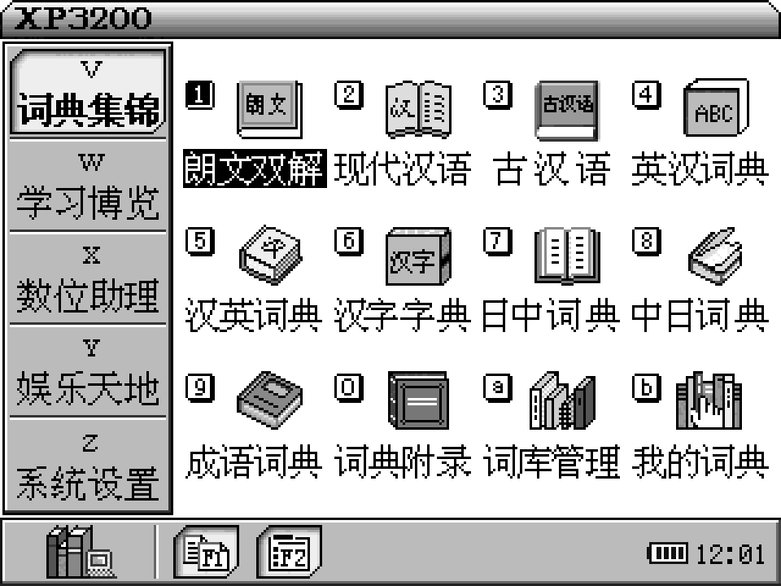
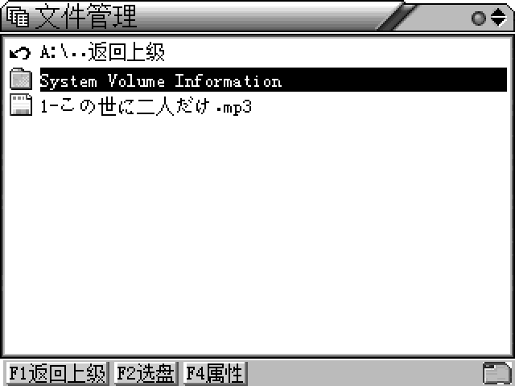
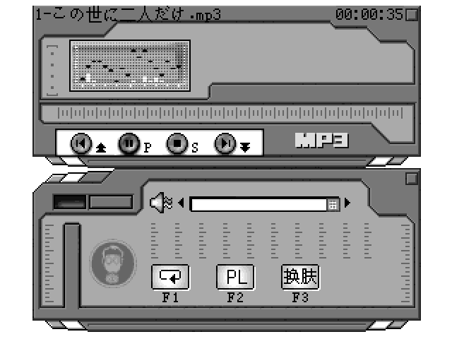
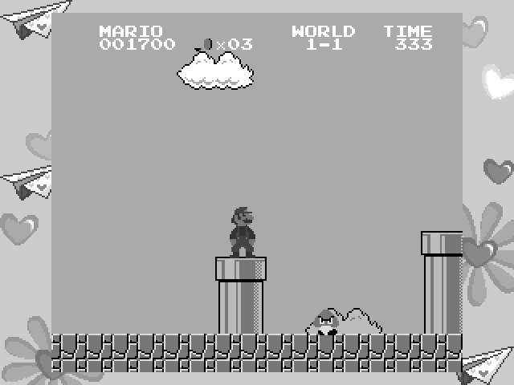

# 好易通 XP3200 QEMU 模拟器

这是基于 QEMU 11 实现的好易通 XP3200 硬件模拟器，模拟 Epson S1C33L05
处理器、`320 × 240` 屏幕、5 行 × 14 列键盘、NAND/NOR、SD 卡、VS1003
音频及相关板级硬件。

源码仓库和模拟器 ZIP 不包含原厂固件、NAND 镜像或 SD 卡镜像。可以运行
Release 中单独提供的测试镜像，或使用自己从真机备份的镜像。

本模拟器基于 [bbk9288-emulator](https://github.com/HelloClyde/bbk9288-emulator)
修改而来：QEMU 基础、S1C33 CPU、9288 机型及其工具都来自上游；XP3200 机型
`hw/s1c33/xp3200.c` 与配套文档/脚本为本项目新增。仓库中仍保留 9288 的
源码与工具（`bbk9288s.c`、`run-bbk9288*`、`web/` 等），与 XP3200 互不影响。

## XP3200 硬件配置

| 项目 | 规格 |
|---|---|
| 处理器 | EPSON S1C33L05 |
| 存储 | 8 MB SDRAM（HY57V641620HGT）；1 MB NOR FLASH + 128 MB NAND FLASH（K9F1G08U0D） |
| 显示 | 320 × 240，4 bpp，16 级灰度 STN-LCD |
| 声音 | VS1003B |
| 键盘 | 67 键（5 行 × 14 列矩阵键盘） |
| 外部接口 | USB 1.1 mini USB-B；2.5 mm 耳机接口 |
| 供电 | 2 节 7 号电池，或从 USB 接口取电 |

引脚与地址连接见 [硬件连接](docs/xp3200/hardware.md)。

## 效果预览

系统主菜单（词典集锦/学习博览/数位助理/娱乐天地/系统设置）：



SD 卡（A 盘）文件管理，支持中文/日文长文件名：



固件自带 MP3 播放器，从 SD 卡读取并送 VS1003 解码：



`下载游戏` 里的 NES 游戏（MARIO）：



## 已实现

- QEMU machine type：`xp3200`。
- 320 × 240 LCDC、IVRAM 及 1/2/4/8 bpp 调色板渲染，支持 `debug-lcd-dump-*`
  导出 PGM 帧用于自动化验证。
- S1C33L05 标准外设：16 位/8 位定时器、HSDMA、SIO、中断控制器、看门狗等
  启动与日常运行所需部分。
- NOR 启动：`-bios` 执行原机 NOR 中的龙腾 V1.1 引导/恢复系统，再加载
  NAND 中的主 OS（`XP3200V1.9.5`）。
- Samsung 兼容 128 MiB NAND、2 KiB 页、OOB，NAND 按脏块增量回写；
  原厂 FTL / `NFDISK` FAT16 文件系统可读。
- 5 行 × 14 列键盘矩阵：`0x00300F46` 行选通、K5/P0 列输入、K6.4 唤醒，
  第 5 行热键（音量/Font/Catalog/U 盘等）已全部打通。
- 按键即时唤醒：矩阵键不再需要长按约 1 秒才响应。
- SD 卡（S1C33L05 MMC，SPI 模式）：CMD0/1/8/9/10/12/13/16/17/18/24/25/55/58/59，
  MBR + FAT16（A 盘），支持中文/日文 VFAT 长文件名。
- 固件 CSD 字节序适配：按固件解析方式生成 CSD，扇区上限正确（见
  [技术说明](docs/xp3200/progress.md) 第 13 节）。
- VS1003 压缩音频数据通路：固件从 SD 卡读取 MP3 并送解码器，模型通过
  `audio-player`（如 `ffplay`）播放；已实测播放 35 秒、送解码器数据与
  卡上文件逐字节一致。
- NES 游戏：`下载游戏` 中的 `.GAM`/`.NES` 可正常进入并操作。
- SD 卡镜像工具（图形界面 + 命令行），见下文。
- 调试支持：GDB-RSP stub、`debug-lcd-dump-*`、`debug-call-*`、`debug-sd-insert-ms`、
  `F12` 工厂自检菜单等。

当前固件可进入完整主菜单，词典/学习/娱乐/系统设置各页面可操作，
文件管理可浏览 A 盘（SD 卡）和 C 盘（NAND），MP3 可播放，NES 游戏可运行。

## 快速开始

仓库不包含原厂固件与镜像。运行前需要准备：

- NOR 镜像（原机 1 MiB NOR FLASH，或等价引导 ROM）；
- NAND 镜像（128 MiB，含 `NFDISK` 文件系统）；
- 可选：SD 卡镜像（FAT16，可用下方工具生成）。

启动：

```bash
./_build/qemu-system-s1c33 \
  -M "xp3200,nand-image=nand.img,sd-image=sdcard.img" \
  -bios nor.bin \
  -cpu c33l05,exit-on-halt=off \
  -display gtk
```

- `-display gtk` 需要图形环境（WSL2 下需 WSLg）；无图形时用 `-display none`。
- 听声音时加 `,audio-player=/usr/bin/ffplay`：模型把固件送 VS1003 的压缩流
  通过管道交给 ffplay 解码播放。
- 热插拔 SD 卡调试：`,debug-sd-insert-ms=<毫秒>`（开机时卡不在位，到点后插入）。

## 构建

在 Linux / WSL2 中：

```bash
# 在仓库根目录执行
mkdir -p _build && cd _build
../configure \
  --target-list=s1c33-softmmu \
  --without-default-features \
  --enable-tcg \
  --enable-pixman \
  --disable-sdl \
  --enable-gtk \
  --enable-vnc \
  --disable-docs \
  --disable-tools \
  --disable-werror \
  --enable-download
ninja qemu-system-s1c33
```

依赖：`build-essential ninja-build meson pkg-config libglib2.0-dev
libpixman-1-dev libgtk-3-dev`。

确认机型：

```bash
./qemu-system-s1c33 -machine help | grep xp3200
```

## SD 卡镜像工具

`scripts/xp3200/` 提供生成和编辑 FAT16 SD 卡镜像的工具：

- `SDImageTool.ps1`：Windows 图形界面（新建镜像、编辑已有镜像、添加/删除文件）；
- `sd_image.sh`：命令行入口（`create` / `add` / `delete` / `list`）；
- `fat16_list.py`、`fat16_lba.py`、`mk_mbr.py`：镜像解析与 MBR 写入。

生成规则与真机 128 MB 卡一致：MBR 分区表（类型 `0x06`，起始 LBA 97）+
FAT16，支持中文/日文长文件名。需要 `dosfstools`（`mkfs.vfat`）和 `mtools`。

```bash
bash scripts/xp3200/sd_image.sh create ~/card.img 128 "SD CARD" ~/音乐 ~/电子书
```

详见 [SD 卡镜像工具](docs/xp3200/sdcard-tool.md)。

## 键盘

按键映射（PC 主机键 → 本机键、矩阵行列、固件位置）见
[键盘映射](docs/xp3200/keyboard.md)。整机 5 × 14 矩阵 67 键全部可映射，
包括第 5 行的音量、字体、U 盘、词典、发音等热键。

## 调试

- GDB-RSP：`-gdb tcp::2349`，可下断点、单步、读写 guest 内存；
- LCD 帧导出：`,debug-lcd-dump-path=<前缀>` + QMP `debug-lcd-dump-seq`；
- 工厂自检菜单：按 `F12`（等价 `debug-call-addr=0x0217D6CE`）；
- SD 热插拔：`,debug-sd-insert-ms=<毫秒>`。

源码组织与阅读顺序见 [源码结构与阅读指南](docs/xp3200/source-guide.md)；
更完整的调试记录与逆向过程见 [移植进度](docs/xp3200/progress.md)。

## 代码结构

- `hw/s1c33/`：S1C33 板级设备；`xp3200.c` 为 XP3200 machine（LCD、NAND、NOR、
  键盘、SD、音频、定时器等）。
- `target/s1c33/`：Epson S1C33 CPU 翻译、指令 helper 和反汇编。
- `docs/xp3200/`：硬件连接、键盘映射、源码阅读指南、SD 卡工具说明、移植进度与技术笔记。
- `scripts/xp3200/`：SD 卡镜像工具。

## 资料依据

- [Epson S1C33L05 Technical Manual](https://www.epson.jp/prod/semicon/pdf/id000446.pdf)：
  CPU、IVRAM、LCDC、NAND、串行接口及寄存器定义。
- 真机采集的 NOR/NAND/SD 镜像与逻辑分析数据（不随仓库分发）。

## 当前限制

- C 盘（NAND `NFDISK`）目前只读；写入需要 U 盘连接（USB 设备模式）或
  离线 FTL 写入，尚未实现。
- 音频由 `ffplay` 负责 MPEG 解码，不模拟 VS1003 内部音质、模拟输出和
  全部 SCI 扩展行为。
- USB、部分板级扩展寄存器仍为实验性模型。
- 此项目是非官方逆向工程，与好易通、Epson 或 QEMU 项目没有隶属关系。

## 许可证

模拟器源码沿用 QEMU 的许可证体系；整体按仓库根目录 `LICENSE`、`COPYING`
和各源文件中的许可证声明发布。请勿在 Issue、PR 或提交中上传无权再分发的
原厂固件、NAND 镜像、说明书或安装包。
